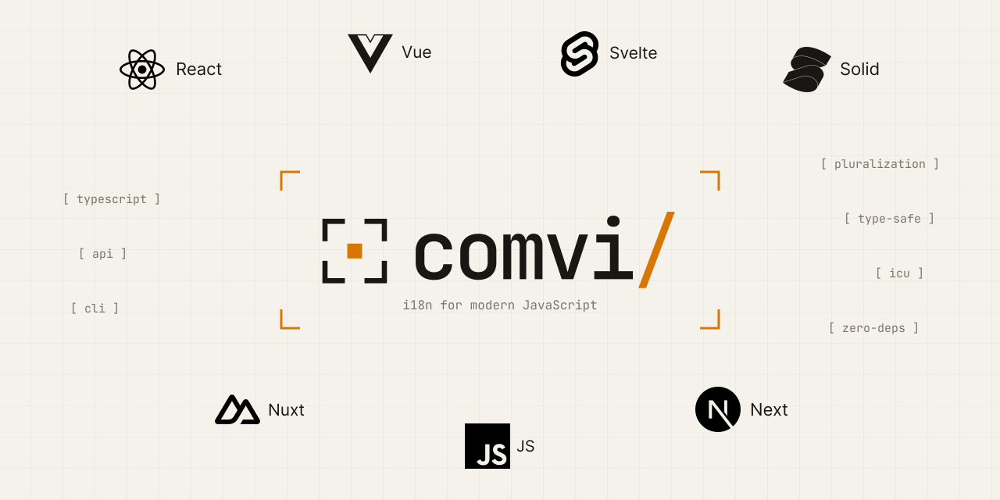

<p align="center">
  <picture>
    <source media="(prefers-color-scheme: dark)" srcset="https://raw.githubusercontent.com/comvi-io/comvi-js/main/.github/assets/header-logo-dark.svg">
    
  </picture>
</p>

<h1 align="center">Comvi i18n</h1>

<p align="center">
  A small, framework-agnostic i18n library with bindings for <b>React</b>, <b>Next.js</b>, <b>Vue</b>, <b>Nuxt</b>, <b>Svelte</b> and <b>Solid</b>,<br/>
  and a platform that serves translations over a CDN.
</p>

<p align="center">
  <a href="https://www.npmjs.com/package/@comvi/core"></a>
  <a href="https://bundlejs.com/?q=@comvi/react&amp;treeshake=%5B%7BcreateI18n%2CI18nProvider%2CuseI18n%7D%5D&amp;config=%7B%22esbuild%22%3A%7B%22external%22%3A%5B%22react%22%2C%22react-dom%22%2C%22react/jsx-runtime%22%5D%7D%7D"></a>
  <a href="https://github.com/comvi-io/comvi-js/actions/workflows/ci.yml"></a>
  <a href="LICENSE"></a>
  <a href="https://comvi.io"></a>
</p>

<p align="center">
  <b><a href="https://comvi.io/docs/i18n">Documentation</a></b>
  &nbsp;·&nbsp;
  <b><a href="https://comvi.io/docs/i18n/quick-start">Quick start</a></b>
  &nbsp;·&nbsp;
  <b><a href="examples/README.md">Live examples</a></b>
  &nbsp;·&nbsp;
  <b><a href="https://comvi.io">Comvi Platform</a></b>
</p>

---

Comvi i18n renders translated text from a catalog in your source or from the
[Comvi platform](https://comvi.io) over a CDN. Install the package for your framework, create one
i18n instance and call `t()` in components.

## Install

Pick the line for your framework. `@comvi/core` is on each line because the app imports its
subpaths (`@comvi/core/cdn` for the CDN loader).

```bash
npm install @comvi/react @comvi/core
npm install @comvi/next @comvi/react @comvi/core
npm install @comvi/vue @comvi/core
npm install @comvi/nuxt
npm install @comvi/svelte @comvi/core
npm install @comvi/solid @comvi/core
npm install @comvi/core
```

| Framework          | Package         | Peer dependencies | Guide                                         | Try it                                                                                   |
| ------------------ | --------------- | ----------------- | --------------------------------------------- | ---------------------------------------------------------------------------------------- |
| React              | `@comvi/react`  | `react`           | [React](https://comvi.io/docs/i18n/react)     | [StackBlitz](https://stackblitz.com/github/comvi-io/comvi-js/tree/main/examples/react)   |
| Next.js            | `@comvi/next`   | `next`, `react`   | [Next.js](https://comvi.io/docs/i18n/next)    | [StackBlitz](https://stackblitz.com/github/comvi-io/comvi-js/tree/main/examples/next)    |
| Vue                | `@comvi/vue`    | `vue`             | [Vue](https://comvi.io/docs/i18n/vue)         | [StackBlitz](https://stackblitz.com/github/comvi-io/comvi-js/tree/main/examples/vue)     |
| Nuxt               | `@comvi/nuxt`   | `nuxt`            | [Nuxt](https://comvi.io/docs/i18n/nuxt)       | [StackBlitz](https://stackblitz.com/github/comvi-io/comvi-js/tree/main/examples/nuxt)    |
| Svelte             | `@comvi/svelte` | `svelte`          | [Svelte](https://comvi.io/docs/i18n/svelte)   | [StackBlitz](https://stackblitz.com/github/comvi-io/comvi-js/tree/main/examples/svelte)  |
| Solid              | `@comvi/solid`  | `solid-js`        | [Solid](https://comvi.io/docs/i18n/solid)     | [StackBlitz](https://stackblitz.com/github/comvi-io/comvi-js/tree/main/examples/solid)   |
| Vanilla JavaScript | `@comvi/core`   | none              | [Vanilla](https://comvi.io/docs/i18n/vanilla) | [StackBlitz](https://stackblitz.com/github/comvi-io/comvi-js/tree/main/examples/vanilla) |

The packages are ESM-only and released together, so install the same version of every
`@comvi/*` package. With two copies of `@comvi/core` in one app nothing fails at import: an error
that names both versions is thrown when an instance created by one copy reaches code of the other
(a binding, or `@comvi/core/format`). The runtime packages need Node 20 or newer (`@comvi/nuxt`
22.20), `@comvi/cli` and `@comvi/vite-plugin` Node 22. An example that does not open in StackBlitz
runs locally: [examples](examples/README.md).

## Quick start

Create the i18n instance and hand it to React, in `src/main.tsx`:

```tsx title="src/main.tsx" check=group=index-1
import { createRoot } from "react-dom/client";
import { createI18n, I18nProvider, useI18n } from "@comvi/react";

const i18n = createI18n({
  locale: "en",
  fallbackLocale: "en",
  messages: {
    en: { greeting: "Hello, {name}!" },
    uk: { greeting: "Привіт, {name}!" },
  },
});

function App() {
  const { t } = useI18n();
  return <h1>{t("greeting", { name: "Alice" })}</h1>;
}

createRoot(document.getElementById("root")!).render(
  <I18nProvider i18n={i18n}>
    <App />
  </I18nProvider>,
);
```

`<I18nProvider>` hands the i18n instance to the tree, and `useI18n()` gives your components
`t()`, the current locale and `setLocale()`. Every binding has the same shape: create the
instance, hand it to the framework, call `useI18n()` in components. The other frameworks are on
[Quick start](https://comvi.io/docs/i18n/quick-start).

### How it works

`createI18n()` returns the i18n instance, ready on the next line: it holds the catalogs, the
current locale and `t()`. A binding hands the instance to your framework and re-renders what reads
it when the locale or a catalog changes. ICU `plural`, `select` and `selectordinal` and `<tag>`
markup are part of every message, with nothing to turn on. Everything else is an option of
`createI18n()` that you import from a subpath of `@comvi/core`: a `loader` for catalogs that
arrive later, and `plugins` for locale detection and the in-context editor. A subpath you never
import never enters your bundle. What the library does not do is listed on
[Limitations](https://comvi.io/docs/i18n/limitations).

## Connect to Comvi

The CDN loader is `cdn()` from `@comvi/core/cdn`. Pass it as the instance's `loader`, in
`src/main.tsx`:

```tsx title="src/main.tsx" check=group=connect-comvi-react-1
import { createRoot } from "react-dom/client";
import { createI18n, I18nProvider } from "@comvi/react";
import { cdn } from "@comvi/core/cdn";
import App from "./App";

const i18n = createI18n({
  locale: "en",
  fallbackLocale: "en",
  loader: cdn("https://cdn.comvi.io/<project-token>"),
});

createRoot(document.getElementById("root")!).render(
  <I18nProvider i18n={i18n} loading={<div className="spinner" />}>
    <App />
  </I18nProvider>,
);
```

`cdn(url)` fetches each locale's catalog from the CDN when the instance needs it, and `loading` is
what the provider renders until a catalog is usable or the initial loads have all failed. The CDN
URL comes from **Settings → Content Deploy** in the Comvi project; the walkthrough is
[Connect to Comvi](https://comvi.io/docs/i18n/connect-comvi). A server that renders per request
passes one `createCatalogStore()` to every instance's loader (`cdn(url, { store })`), so requests
share the fetched catalogs.

Do not add `messages` for a catalog the loader should fetch. An inline catalog switches off
loading for its pair of locale and namespace: with `messages: { en }` beside this loader, `en`
is never fetched for the `default` namespace, while the other namespaces of `en` and every other
locale still are. To bundle a catalog for when the CDN does not answer, pass
`cdn(url, { fallback: { en: () => catalog } })`. It is a spare, not a base the CDN lays over:
while the CDN answers, a key that only the spare has renders as a key
([`messages` and `loader`](https://comvi.io/docs/i18n/limitations#messages-and-loader)).

## Subpaths and tooling

| Package                                      | What it does                                                                     | Docs                                                                      |
| -------------------------------------------- | -------------------------------------------------------------------------------- | ------------------------------------------------------------------------- |
| [`@comvi/core/cdn`](packages/core)           | Load catalogs from the Comvi CDN, with a bundled spare                           | [Connect to Comvi](https://comvi.io/docs/i18n/connect-comvi)              |
| [`@comvi/core/plugins`](packages/core)       | Detect the locale from query, cookie, storage, browser, and remember a switch    | [Plugins API](https://comvi.io/docs/i18n/api/core-plugins)                |
| [`@comvi/core/format`](packages/core)        | Format numbers, currency, dates, lists and relative time for the locale          | [Formatting](https://comvi.io/docs/i18n/formatting)                       |
| [`@comvi/editor`](packages/editor)           | Edit translations inside the running app (loaded by the Comvi browser extension) | [In-context editor](https://comvi.io/docs/i18n/plugins/in-context-editor) |
| [`@comvi/vite-plugin`](packages/vite-plugin) | Generate the `Catalogs` types from local JSON at dev/build                       | [Vite plugin](https://comvi.io/docs/i18n/plugins/vite-plugin)             |
| [`@comvi/cli`](packages/cli)                 | Pull, push, check and generate types from the terminal                           | [Comvi CLI](https://comvi.io/docs/cli)                                    |

## Contributing

Bug reports, docs fixes and pull requests are welcome. [CONTRIBUTING.md](CONTRIBUTING.md) explains
the repository layout, the setup and what CI checks.

## License

[MIT](LICENSE) © Comvi
