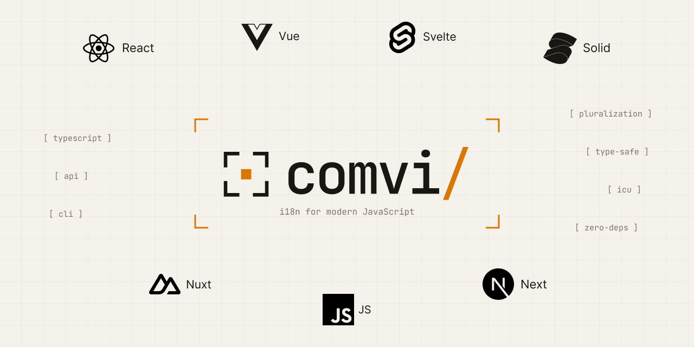

<p align="center">
  <picture>
    <source media="(prefers-color-scheme: dark)" srcset="../../.github/assets/header-logo-dark.png">
    
  </picture>
</p>

<h1 align="center">@comvi/nuxt</h1>

<p align="center">Nuxt module for Comvi i18n: auto-imports, SSR, and locale-prefixed routes.</p>

<p align="center">
  <a href="https://www.npmjs.com/package/@comvi/nuxt"></a>
  <a href="https://github.com/comvi-io/comvi-js/blob/main/LICENSE"></a>
  <a href="https://stackblitz.com/github/comvi-io/comvi-js/tree/main/examples/nuxt"></a>
</p>

---

`@comvi/nuxt` is the Comvi i18n module for Nuxt 3 and 4: it creates one i18n instance per request,
renders the page's translations on the server, starts the browser from that render, and clones your
pages into locale-prefixed routes. `useI18n()`, `useFormat()`, `<T>` and `$t` are `@comvi/vue`'s own,
auto-imported; the module brings `@comvi/core` and `@comvi/vue` with it.

## Install

```bash
npm install @comvi/nuxt
```

## Setup

The data go to `nuxt.config.ts`, once; the module uses them on the server and in the browser:

```ts title="nuxt.config.ts" check=group=nuxt-app
export default defineNuxtConfig({
  modules: ["@comvi/nuxt"],
  comvi: {
    locales: ["en", "uk"],
    defaultLocale: "en",
    timeZone: "UTC", // required: the server and the browser format dates in one zone
  },
});
```

The functions go to `comvi.i18n.ts` next to it. A dynamic import returns a module, so the loader
returns its `default`, the catalog. Catalogs are nested or flat JSON, `locales/<ns>/<locale>.json`:

```ts title="comvi.i18n.ts" check=group=nuxt-app
import { defineI18nOptions } from "@comvi/nuxt/i18n";

export default defineI18nOptions(() => ({
  loader: async (locale, ns) => (await import(`./locales/${ns}/${locale}.json`)).default,
}));
```

```vue title="app/pages/index.vue" check=group=nuxt-app
<script setup lang="ts">
const { t, locale } = useI18n();
const switchLocalePath = useSwitchLocalePath();
</script>

<template>
  <h1>{{ t("home.title", { name: "Alice" }) }}</h1>
  <p>{{ $t("home.count", { count: 3 }) }}</p>
  <T i18n-key="home.terms">
    <template #link="{ children }"
      ><NuxtLinkLocale to="/terms">{{ children }}</NuxtLinkLocale></template
    >
  </T>
  <NuxtLink :to="switchLocalePath(locale === 'en' ? 'uk' : 'en')">Switch</NuxtLink>
</template>
```

Switching the language is a navigation: the URL, the text, the cookie and `<html lang dir>` move
together, and the old text stays until the new catalogs are in. `setLocale()` changes the instance
only (the text and the cookie, not the URL; the next navigation applies the URL's locale): use it as
the switch with `localePrefix: "never"`. A switch whose catalogs all fail keeps the locale on screen
and its URL. Navigate with `<NuxtLink>` or `router.push`: while a switch loads, Nuxt answers a
`navigateTo()` called from a click with the location only.

For a two-line start, `comvi.messages: { en: { … }, uk: { … } }` in `nuxt.config.ts` gives the
`default` namespace without files; those catalogs are compiled into the app bundle.

## A page that waits for its namespace

`useI18n("account")` loads the page's namespace on the server render and, on a client navigation,
shows the loading branch until it is in. To keep the previous page on screen instead, load it
explicitly and wait for the result:

```vue title="app/pages/account.vue" check=group=nuxt-app
<script setup lang="ts">
const { t, isReady, isLoading, i18n } = useI18n("account");
// The error is already reported through `onError`; the page shows the fallback or "unavailable".
if (isLoading.value) await i18n.load("account").catch(() => {});
</script>

<template>
  <h1 v-if="isReady">{{ t("title") }}</h1>
  <p v-else-if="isLoading">…</p>
  <button v-else @click="i18n.load('account').catch(() => {})">Retry</button>
</template>
```

At hydration nothing is loading, so the line does nothing and asks for nothing. It inherits
`load()`'s retry semantics: `load(ns)` asks every pair of `ns` not in place, a failed one too, and
`isLoading` can be true while one pair of the chain loads and another has already failed. The empty
`.catch` does not ignore the error: `onError` has reported it, and the page renders the fallback or
the "unavailable" branch. A later visit asks nothing again; the button is the retry.

## A private source

A source with a secret lives in the app's own server route; one loader calls it on the server
render, in the browser and from Nitro routes:

```ts title="server/api/i18n/[locale]/[ns].get.ts" check=group=nuxt-private
import { api } from "@comvi/nuxt/i18n";

const load = api("https://api.comvi.io", { key: String(useRuntimeConfig().comviApiKey) });

export default defineEventHandler(async (event) => {
  const { locale, ns } = getRouterParams(event);
  const { locales } = useRuntimeConfig(event).public.comvi;
  // The app's own list, and its own access rule: a parameter never reaches the source unchecked.
  if (!locales.includes(locale!) || !["default", "account"].includes(ns!))
    throw createError({ statusCode: 404 });
  return load(locale!, ns!, AbortSignal.timeout(10_000));
});
```

```ts title="comvi.i18n.ts" check=group=nuxt-private
import { defineI18nOptions } from "@comvi/nuxt/i18n";

export default defineI18nOptions((event) => {
  // On a server, the request's own fetch: it forwards the user's cookies and calls the route
  // in-process. In the browser `event` is undefined and `$fetch` sends them itself.
  const fetch = event?.$fetch ?? $fetch;
  return {
    loader: (locale, ns, signal) => fetch(`/api/i18n/${locale}/${ns}`, { signal, retry: 0 }),
  };
});
```

`retry: 0` applies to any loader built on `$fetch` where one attempt is wanted: `$fetch` repeats a
failed GET once otherwise, and the retry belongs to `i18n.load(ns)`. A protected route also needs the
request forwarded through `event.$fetch`. The route must exist: Nuxt renders an unknown `/api/…` path
as a page, whose loader would call it again. The key stays in the server build.

### How it works

On a server the module resolves the request's locale (URL, cookie, `Accept-Language`) before the
instance exists, creates it in that locale, waits for its catalogs and for each `useI18n(ns)` of the
page, and writes one snapshot into the Nuxt payload after the render. The browser creates its
instance from that snapshot before any component renders, so hydration asks the loader for nothing,
a catalog the server failed included (it renders the fallback the server rendered until a retry).
After it, every new namespace comes from the browser's loader. `useNuxtApp().$i18n` is the instance
outside a component. In a Nitro route, `useTranslation(event, { ns?, locale? })` returns
`{ t, locale, dir, i18n }` on the same options; every server instance ends with its request.

## Routing

| `localePrefix` | Default locale | Other locale                                                  |
| -------------- | -------------- | ------------------------------------------------------------- |
| `as-needed`    | `/about`       | `/de/about`                                                   |
| `always`       | `/en/about`    | `/de/about`                                                   |
| `never`        | `/about`       | `/about`, locale from the cookie or `Accept-Language` instead |

A URL that names no locale reads it from `localeDetection.order` (the query, the `i18n_locale` cookie,
`Accept-Language`); the module records the locale in the cookie. `localeCookie` takes a name,
`{ name, maxAge, secure, sameSite, domain }` or `false`; `localeDetection` takes
`{ order, queryParam, headerName, resolveAcceptLanguage }` or `false`. `useLocalePath()`,
`useSwitchLocalePath()`, `useLocaleRoute()`, `useRouteConfig()` and `<NuxtLinkLocale>` build the
links; `useLocaleHead()` adds canonical, hreflang and `og:locale`. Set `comvi.head: false` to write
`<html lang dir>` yourself. `fallbackLocale`, `namespaces` and `formats` are `comvi` options too.

## Read next

- [Nuxt guide](https://comvi.io/docs/i18n/nuxt): rich text, SSR, locale routing.
- [Server-side rendering](https://comvi.io/docs/i18n/ssr#nuxt): the per-request instance and the handover.
- [Connect to Comvi](https://comvi.io/docs/i18n/connect-comvi): `cdn()` and `api()` from `@comvi/nuxt/i18n`.

## Contributing

Bug reports, docs fixes and pull requests are welcome.
[CONTRIBUTING.md](https://github.com/comvi-io/comvi-js/blob/main/CONTRIBUTING.md) explains the setup
and what CI checks.

## License

[MIT](https://github.com/comvi-io/comvi-js/blob/main/LICENSE) © Comvi
