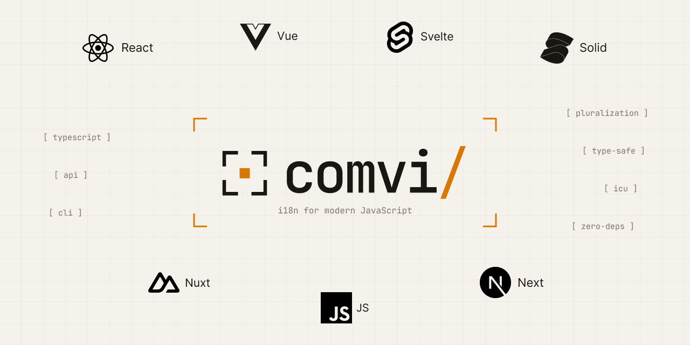

<p align="center">
  <picture>
    <source media="(prefers-color-scheme: dark)" srcset="../../.github/assets/header-logo-dark.png">
    
  </picture>
</p>

<h1 align="center">@comvi/svelte</h1>

<p align="center">Svelte 5 bindings for Comvi i18n: <code>setI18n()</code>, <code>useI18n()</code> and the <code>&lt;T&gt;</code> component.</p>

<p align="center">
  <a href="https://www.npmjs.com/package/@comvi/svelte"></a>
  <a href="https://github.com/comvi-io/comvi-js/blob/main/LICENSE"></a>
  <a href="https://stackblitz.com/github/comvi-io/comvi-js/tree/main/examples/svelte"></a>
</p>

---

`@comvi/svelte` binds the Comvi i18n instance to Svelte 5 with runes: `setI18n(i18n)` in the root
component, `useI18n()` in components, and `<T>` for translations that contain markup.

## Install

```bash
npm install @comvi/svelte @comvi/core # peer: svelte ^5.3.0; the app imports @comvi/core/cdn
```

## Setup

```ts title="src/i18n.ts"
import { createI18n } from "@comvi/svelte";

export const i18n = createI18n({
  locale: "en",
  messages: { en: { greeting: "Hello, {name}!" }, uk: { greeting: "Привіт, {name}!" } },
});
```

```svelte title="src/App.svelte"
<script lang="ts">
  import { setI18n, useI18n } from "@comvi/svelte";
  import { i18n } from "./i18n";

  setI18n(i18n);
  const r = useI18n();
  const t = r.t;
</script>

<h1>{t("greeting", { name: "Alice" })}</h1>
<select value={r.locale} onchange={(e) => r.setLocale(e.currentTarget.value)}>
  <option value="en">English</option>
  <option value="uk">Українська</option>
</select>
```

`t()` fills `{name}` from its second argument (`{ ns }`, `{ locale }` there apply to one call) and
re-runs in a template or a `$derived` when the instance's state changes. It always returns a
string: a tag handler's output joins into it, and rich text is `<T>`'s. `locale`, `dir`, `isReady`
and `isLoading` are getters, as `page` of `$app/state`: read them through the object (`r.locale`);
destructured in a `<script>`, one is read once. `setLocale()` switches once the new catalogs are in
(the last of quick switches wins); it rejects for an invalid tag, or when no catalog of the locale
or its parent (`de` for `de-AT`) loaded for any namespace it waited for.

```svelte title="src/Account.svelte"
<script lang="ts">
  import { useI18n } from "@comvi/svelte";
  const account = useI18n("account");
</script>

{#if account.isReady}<h2>{account.t("title")}</h2>
{:else if account.isLoading}<p class="spinner"></p>
{:else}<p>Not available</p>{/if}
```

`useI18n("account")` binds `t` and `T` and holds the namespace from mount to destroy: it loads for
the locale on screen and every switch; with no component holding it, it stays cached and a switch
skips it. `isReady`: a catalog of the locale on screen, its parent or a `fallbackLocale` is in;
`isLoading`: one is on the way. A failed load is `false`/`false` only with no usable catalog; a
remount does not retry, `i18n.load("account")` does. `t()` and `<T>` only read (development warns
about a namespace nothing loads). Nothing gates the first paint: `await i18n.ready` before
`mount()`, or read `isReady`.

`useFormat()` from `@comvi/svelte/format` formats numbers, currency, dates, ranges, lists, display
names and relative time in the locale on screen; what calls one re-runs on a switch.

## Load from Comvi

`src/i18n.ts` gets the loader, and `main.ts` waits for that same instance, the one `App.svelte`
passes to `setI18n()`:

```ts title="src/i18n.ts"
import { createI18n } from "@comvi/svelte";
import { cdn } from "@comvi/core/cdn";
export const i18n = createI18n({
  locale: "en",
  loader: cdn("https://cdn.comvi.io/<project-token>"),
});
```

```ts title="src/main.ts"
import { mount } from "svelte";
import App from "./App.svelte";
import { i18n } from "./i18n";
i18n.ready.then(() => mount(App, { target: document.body }));
```

## Markup in a translation

```svelte
<script lang="ts">
  import { T } from "@comvi/svelte";
  import Note from "./Note.svelte"; // <em>{@render children?.()}</em>
</script>

<!-- "terms": "Read the <link>terms</link>,<br/><b>in <i>full</i></b>." -->
<T i18nKey="terms" components={{ b: "strong", i: Note, br: "br" }}>
  {#snippet link(children: string)}<a href="/terms">{children}</a>{/snippet}
</T>
```

A tag renders through its `components` entry (a tag name, a component, or `{ component: "a", props: { href: "/terms" } }`; the content is its
`children` snippet, nested tags included; an empty tag passes none, so `br: "br"` is a real `<br>`),
else a snippet of its name (`children` is the tag's text: nested markup is flattened, and
development warns; a snippet can also be passed as a prop, `link={terms}`), else as text. `<T>`
takes no handler: a function prop is a snippet. Every other prop but `i18nKey`, `ns`, `locale` and `markers` is a
param, always printed as text: markup goes in a tag around it (`"Hello, <strong>{name}</strong>!"`
with `components={{ strong: "strong" }}`). `useI18n("shop").T` is `<T>` bound to that namespace.

## Server rendering

An instance per request. `render()` of `svelte/server` is synchronous, so a route loads what it
shows first: `await i18n.ready`, `await i18n.load(ns)`; a namespace held with no catalog renders its
loading branch. Match a locale from a route, cookie or header against your supported locales first:
`createI18n()` throws a `RangeError` for one that is not a tag.

```ts title="src/routes/+layout.server.ts"
import { createI18n, handover } from "@comvi/svelte";
import { locales, options } from "$lib/i18n"; // options: { timeZone: "UTC", loader, … }; timeZone required

export const load = async ({ params }) => {
  const locale = locales.includes(params.locale) ? params.locale : "en";
  const i18n = createI18n({ ...options, locale });
  await i18n.ready;
  return handover(i18n);
};
```

In `+layout.svelte`, `setI18n(createI18n({ ...options, ...data }))` starts from the server's state:
the same `isReady`/`isLoading`, no mismatch, nothing fetched that the server rendered. A later
payload goes through `i18n.add(locale, catalog, ns)` and `setLocale()`: see
[`examples/sveltekit`](https://github.com/comvi-io/comvi-js/tree/main/examples/sveltekit).

## Read next

- [Svelte guide](https://comvi.io/docs/i18n/svelte): markup inside a translation, first paint, SSR.
- [Loading translations](https://comvi.io/docs/i18n/loading-translations): loaders, namespaces, fallbacks.

## License

[MIT](https://github.com/comvi-io/comvi-js/blob/main/LICENSE) © Comvi
