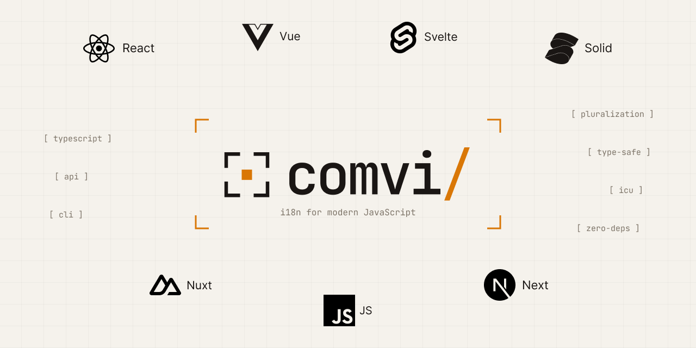

<p align="center">
  <picture>
    <source media="(prefers-color-scheme: dark)" srcset="../../.github/assets/header-logo-dark.png">
    
  </picture>
</p>

<h1 align="center">@comvi/vue</h1>

<p align="center">Vue 3 binding for Comvi i18n — plugin, composable, and <code>&lt;T&gt;</code> component.</p>

<p align="center">
  <a href="https://www.npmjs.com/package/@comvi/vue"></a>
  <a href="https://bundlephobia.com/package/@comvi/vue"></a>
  <a href="https://github.com/comvi-io/comvi-js/blob/main/LICENSE"></a>
</p>

---

`@comvi/vue` wraps [`@comvi/core`](../core) for Vue 3. `app.use(i18n)` installs `$t` and `$i18n` global properties; `useI18n()` returns reactive refs that integrate with Vue's reactivity system.

Same `t()` and `<T>` API as the [React](../react), [SolidJS](../solid), and [Svelte](../svelte) bindings, so switching frameworks doesn't mean relearning your i18n layer.

For Nuxt 3, use [`@comvi/nuxt`](../nuxt), which adds SSR, locale routing, and auto-imports on top of this package.

📖 **Documentation:** https://comvi.io/docs/i18n/vue/

## Why Comvi i18n?

Comvi i18n is a framework-agnostic internationalization library with type-safe translations, real ICU MessageFormat, and a small bundle.

- **Rich text without XSS.** Embed components inside translation strings (`Click <link>here</link>`). Translators see clean markup, and you decide what each tag renders to. No raw HTML, no unsafe DOM injection, and no splitting a sentence across template fragments.
- **ICU `plural`, `selectordinal` & `select`.** Locale-correct grammar via `Intl.PluralRules`, including Polish, Ukrainian, Arabic, Welsh and the rest. It is the same syntax every major TMS (Crowdin, Lokalise, Phrase) already speaks. The `number` / `date` / `time` argument types and the plural `offset:` form are not implemented and are not planned. Each one fails with `E_ICU_SYNTAX` instead of rendering something wrong.
- **Locale-aware formatters built in.** `formatNumber`, `formatDate`, `formatCurrency`, and `formatRelativeTime` follow the active locale via native `Intl`, with reactive updates in every framework binding.
- **~7.0 kB minified + gzipped for a default app graph (measured, `vue` externalized), zero runtime dependencies.** That is the base host plus the vue bindings and the `VueI18n` preset; ICU, async loading, the plugin host and devtools discovery cost only where you compose them. No `eval` or `new Function` anywhere, so it runs under a strict CSP without `unsafe-eval`. Safe for Chrome extensions, Cloudflare Workers, and locked-down enterprise apps.
- **Pluggable.** Translation loading (CDN/API), locale detection, and in-context editing are opt-in plugins via `@comvi/plugin-fetch-loader`, `@comvi/plugin-locale-detector`, and `@comvi/plugin-in-context-editor`, one lowercase `.use(installer)` each. You only ship what you use.
- **Same API across 6 frameworks.** `useI18n()` and `<T>` look the same in [Vue](https://www.npmjs.com/package/@comvi/vue), [React](https://www.npmjs.com/package/@comvi/react), [SolidJS](https://www.npmjs.com/package/@comvi/solid), [Svelte](https://www.npmjs.com/package/@comvi/svelte), [Next.js](https://www.npmjs.com/package/@comvi/next), and [Nuxt](https://www.npmjs.com/package/@comvi/nuxt), so switching frameworks doesn't mean relearning your i18n layer.

## Why @comvi/vue?

- **Reactivity first.** `useI18n()` returns Vue refs and computed properties, so a change to the language or the translations triggers precise re-renders without manual store subscriptions.
- **Template-native API.** `<T>` component uses named slots for tag interpolation; `$t` template helper and `$i18n` global property eliminate boilerplate in Options API code.
- **Single plugin, both APIs.** One `app.use(i18n)` install covers the Composition API, the Options API, and component templates.

## Install

```bash
npm install @comvi/vue
# Peer: vue ^3.0.0
```

## Quick start

```ts
// main.ts
import { createApp } from "vue";
import { createI18n } from "@comvi/vue";
import App from "./App.vue";

const i18n = createI18n({
  locale: "en",
  fallbackLocale: "en",
  translation: {
    en: { greeting: "Hello, {name}!" },
    uk: { greeting: "Привіт, {name}!" },
  },
});

createApp(App).use(i18n).mount("#app");
```

```vue
<!-- App.vue -->
<script setup lang="ts">
import { useI18n } from "@comvi/vue";
const { t, locale, setLocale } = useI18n();
</script>

<template>
  <h1>{{ t("greeting", { name: "Alice" }) }}</h1>
  <select :value="locale" @change="setLocale(($event.target as HTMLSelectElement).value)">
    <option value="en">English</option>
    <option value="uk">Українська</option>
  </select>
</template>
```

That host is the base one: ICU, async loading, the plugin host and devtools
discovery are each one `.use(installer)` on the `createI18n` result, as in
[From the Comvi CDN](#from-the-comvi-cdn) below.

For the `<T>` component (rich text with slot-based tag interpolation), `$t` template helper, type-safe keys, and the full composable API, see the [documentation](https://comvi.io/docs/i18n/vue/).

## From the Comvi CDN

Translations served by the Comvi platform, fetched at runtime instead of
bundled. Each capability is one `.use(installer)` on the `createI18n` result,
which keeps the same instance and widens the type of `i18n.core`:

```ts
// main.ts
import { createApp } from "vue";
import { createI18n, icuCompiler } from "@comvi/vue";
import { cdnLoader } from "@comvi/plugin-fetch-loader/cdn";
import App from "./App.vue";

const i18n = createI18n({
  locale: "en",
  fallbackLocale: "en",
  compiler: icuCompiler,
}).use(cdnLoader({ cdnUrl: "https://cdn.comvi.io/your-distribution-id" }));

createApp(App).use(i18n).mount("#app");
```

`compiler: icuCompiler` is the one way to enable ICU, and it works whatever the
catalogs come from; drop the option if the project uses no plural/select. The
one rule left is vue's own: compose before `app.use(i18n)`.

There is no `i18n.init()` call here because `app.use(i18n)` initializes the host
itself. The first paint therefore happens while the catalog is still in flight,
so gate it on the `isLoading` ref from `useI18n()`.

The distribution id in `cdnUrl` comes from the Comvi platform: open your project
and read it off the **Distributions** page.

## Capability composables: `useI18nLoader()` / `useI18nPlugins()`

Async loading and the plugin host are `@comvi/core` **capabilities** rather than
part of the translation core. Since 0.5.0 you acquire their members explicitly
instead of getting them from `useI18n()`:

```vue
<script setup lang="ts">
import { useI18n, useI18nLoader, useI18nPlugins } from "@comvi/vue";

const { t } = useI18n("admin");
const { addActiveNamespace, removeActiveNamespace, reloadTranslations, onLoadError } =
  useI18nLoader();
const { onMissingKey } = useI18nPlugins();
</script>
```

Neither takes parameters; the namespace argument stays on `useI18n(ns)`. The
bag is referentially stable per host instance (keyed on the core, so two
`VueI18n` wrappers over one host share it).

On a host that lacks the capability the acquisition call throws, in
development **and** production, never a silent no-op:

```
[comvi] This i18n instance has no loader capability. Compose it: .use(loader()) from "@comvi/core/loader", or the lower-level attachLoader.
```

**`VueI18n` dropped its eight instance proxies.** `addActiveNamespace`,
`reloadTranslations`, `registerLoader`, `registerLocaleDetector`,
`registerPostProcessor`, `onMissingKey`, `onLoadError` and plugin registration
(0.4's `use(plugin)`) are gone from the class; the host it wraps is public as
`readonly core`, so registration happens on the host instead:

```diff check=skip:proxy-relocation
-i18n.registerLoader(myLoader);
-i18n.use(FetchLoader({ … }));
+const i18n = createI18n({ locale: "en" }).use(loader()).use(plugins());
+i18n.core.registerLoader(myLoader);
+i18n.core.registerPlugin(FetchLoader({ … }));
```

The `use` the class has today is the composition pipe of decision E,
`.use(installer)`, not 0.4's plugin proxy: it runs an installer and hands the
wrapper back.

Both members are capabilities, so they exist on the host only once that host has
composed them. `registerLoader` comes with `@comvi/core/loader` and
`registerPlugin` with `@comvi/core/plugins`; on the base host `createI18n`
builds, `i18n.core.registerPlugin(…)` is a type error and a `TypeError` at
runtime. Nothing on `VueI18n` is typed present and then throws "missing
capability", so plugin registration left with the rest.

Migrating from 0.4.x: `pnpm codemod:framework-slim "src/**/*.{ts,vue}"` (it
rewrites the destructures and _reports_ the proxy call sites, whose receiver
type is textually undecidable), or the
[0.5.0 migration guide](https://github.com/comvi-io/comvi-js/blob/main/MIGRATION.md).

## Supported hosts and what they cost

`createI18n(options)` keeps its 0.4 signature and still builds the host for you,
a `@comvi/core` base host. ICU, async loading, the plugin host and devtools
discovery are each something you compose, tag syntax is an import you name
yourself, and the wrapper carries none of them by default.

**To compose capabilities, chain `.use(installer)` on the `createI18n` result.**
`use` runs the installer on `i18n.core`, hands back the same `VueI18n`
instance, and widens the type of `core` by what the installer composed, so a
loader member on `i18n.core` type-checks once `loader()` is in the chain:

```ts
import { createI18n, loader, plugins } from "@comvi/vue";

const i18n = createI18n({ locale: "en" })
  .use(loader({ uk: () => import("./uk.json") }))
  .use(plugins());
i18n.core.reloadTranslations(); // typed: `.use` widened `core`
```

Reaching one level down instead, as `createI18n(options).core.use(…)`, still
attaches the capability at runtime, but `createI18n` returns
`VueI18n<D, I18n<D>>` and `.core.use(…)` does not re-type the wrapper: `i18n.core`
keeps the base type and every later `i18n.core.registerLoader(…)` is a compile
error. The fix is the wrapper pipe above.

`createCore(options)` and `createI18nFromCore(core, options?)` are the escape
hatch for a host built elsewhere: `createCore` is core's own constructor, and
`createI18nFromCore` wraps whatever you hand it, preserving its exact type as
`i18n.core`. Use them when the host is not built next to the app — Nuxt's
`hostModule`, or one host shared between a Vue app and non-Vue code. Everything
ships from the one entry, and `.use(…)` works on a `createI18nFromCore` result
too.

Whole-app comvi graph, min+gz, `vue` externalized (`pnpm size`, rows in
`scripts/size-budgets.json`, each gated at its recorded baseline + 5 %; the
figures below are this branch's measurement):

| app shape                         | size fixture            | min+gz      |
| --------------------------------- | ----------------------- | ----------- |
| base host, one call, no `<T>`     | `fw-vue-default`        | **7111 B**  |
| full explicit composition + `<T>` | `fw-vue-full-composite` | **11805 B** |

`<T>` adds the pure `@comvi/core/rich-text` path. It moved to that path in this
release and no longer registers ambient string-API tags, so its graph excludes
the tag-registration pair just as the rows that never render it do.

## One package, one entry

`@comvi/vue` is the whole toolkit: all three constructors, the base `I18n`
class, the vue bindings, and core's capability installers as **named**
re-exports. One entry, one build pass, one injection key. A vue app names one
package and nothing else, and no sibling entry exists whose `app.use(i18n)`
could be invisible to this one's `useI18n()`. Migrating a 0.4 app is
`pnpm codemod:framework-slim "src/**/*.{ts,vue}"`; the breaks are written up in
the [0.5.0 migration guide](https://github.com/comvi-io/comvi-js/blob/main/MIGRATION.md).

| export                                          | what it is                                                |
| ----------------------------------------------- | --------------------------------------------------------- |
| `createI18n`                                    | the preset: a `VueI18n` over a base host, plus `.use(…)`  |
| `createCore`                                    | core's own constructor, for a host built elsewhere        |
| `createI18nFromCore`                            | wraps that host, preserving its exact type                |
| `I18n`                                          | the base class `createI18n` and `createCore` both produce |
| `icuCompiler`                                   | from `@comvi/core/icu`: the ICU compiler                  |
| `loader`, `attachLoader`, `flattenCatalog`      | from `@comvi/core/loader`                                 |
| `plugins`, `attachPlugins`, `definePlugin`      | from `@comvi/core/plugins`                                |
| `devtools`, `attachDevtools`                    | from `@comvi/core/devtools`                               |
| `VueI18n`, the composables, `T`, the inject key | the vue bindings                                          |

`createI18n` is vue's own function, not a rename: there is a `VueI18n` to
construct, and `ssrLocale` has to reach the host before the reactive ref is
seeded so the ref and `core.locale` cannot disagree for a render. The
composition pipe reads the same as in the other bindings anyway, because
`.use(installer)` is on the `VueI18n` as well as on the host.

**Named, which is the point — and it costs nine 0.4.x names.** The table above
is the whole value surface. 0.4.x carried `export * from "@comvi/core"`, so
every value on core's root entry, except `createI18n` (vue shadowed it with its
own), was also a named export here; a star
re-export of values is a name set webpack can only resolve by keeping the
source module alive, which is how this file once pinned core's whole root entry
into a dev bundle. Types are unchanged (`export type *` is erased before any
bundler sees it), so `import type { TranslationCache } from "@comvi/vue"` still
resolves. These nine **values** do not:

| 0.4.x `import { … } from "@comvi/vue"`                                 | 0.5.0                                                                    |
| ---------------------------------------------------------------------- | ------------------------------------------------------------------------ |
| `formatNumber`, `formatDate`, `formatCurrency`, `formatRelativeTime`   | `useI18n()` returns all four bound to the locale; unbound, `@comvi/core` |
| `getTextDirection`                                                     | `useI18n().dir`; the helper itself, `@comvi/core`                        |
| `TranslationCache`                                                     | `useI18n().translationCache` for the snapshot; the class, `@comvi/core`  |
| `createBoundTranslation`, `translationResultToString`, `createElement` | `@comvi/core`                                                            |

All nine are still exported by `@comvi/core`, a dependency of this package, so
the fix is an import move. Prefer the `useI18n()` members where the table
offers them: they track the locale, where the bare helpers take it as an
argument.

`.use(installer)` is core's composition pipe: `host.use(f)` is `f(host)`. On
vue it goes on the **instance the factory returned**: `const i18n =
createI18n(options).use(f)` runs `f(i18n.core)`, keeps the same wrapper, and
retypes `core` by what `f` composed. Assign the result: a discarded
`i18n.use(f)` still attaches the capability at runtime but leaves the binding's
`core` unwidened. Compose before `app.use(i18n)`: `install` starts `init()`,
which drains the plugin queue once, so a `plugins()` or `.use(…)` composed later
never runs (development warns). `loader(map)` attaches the capability **and**
registers the map; for a plain `LoaderFn`, compose `.use(attachLoader)` and
call `registerLoader(fn)` yourself (it keeps the import-map adapter out of your
bundle).

### Default — text and `{param}` interpolation

```ts
import { createApp } from "vue";
import { createI18n } from "@comvi/vue";
import App from "./App.vue";

const i18n = createI18n({
  locale: "en",
  translation: { en: { hello: "Hello, {name}!" } },
});

createApp(App).use(i18n).mount("#app");
```

### ICU — the `compiler` option

ICU is a constructor option, so it is chosen in the same call as the rest of the
options, whatever the catalogs come from:

```ts
import { createI18n, icuCompiler } from "@comvi/vue";

const i18n = createI18n({
  locale: "en",
  compiler: icuCompiler,
  translation: {
    en: { messages: "{count, plural, one {# message} other {# messages}}" },
  },
});
```

A catalog that arrives from a loader takes the same option, beside `ssrLocale`:

```ts
import { createI18n, icuCompiler, loader } from "@comvi/vue";

const i18n = createI18n({ locale: "en", ssrLocale: "en", compiler: icuCompiler }).use(
  loader({ uk: () => import("./uk.json") }),
);
// i18n.core now carries the loader capability, exactly typed
```

The option is a constructor field held for the instance's life, so it covers a
catalog merged later by a loader as well as a constructor `translation` or an
`addTranslations` call.

### Async loading — `loader()`

```ts
import { createI18n, loader } from "@comvi/vue";

const i18n = createI18n({ locale: "en" }).use(loader({ uk: () => import("./uk.json") }));
// inside a component: const { reloadTranslations } = useI18nLoader();
```

### Plugins — one `.use(installer)`

The three first-party plugin packages ship a lowercase **installer** beside the
uppercase factory. The installer composes the capabilities that plugin needs
(`cdnLoader` attaches `/loader`, then `/plugins`) and registers it, in one
call. One `.use(…)` on the `createI18n` result is the whole setup:

```ts
import { createI18n } from "@comvi/vue";
import { cdnLoader } from "@comvi/plugin-fetch-loader/cdn";

const i18n = createI18n({ locale: "en", defaultNs: "common" }).use(
  cdnLoader({ cdnUrl: "https://cdn.comvi.io/your-distribution-id" }),
);
```

The explicit form is that composition spelled out, and it is what you want when
you register plugins from a list. Compose `loader()` as well when a plugin
registers one. The order of `loader()`, `plugins()` and `devtools()` among
themselves is free, because plugins run at `init()` and every capability
composed before `init()` is attached by then. `VueI18n` does not proxy plugin
registration, so that happens on the host, as `i18n.core.registerPlugin(…)`:

```ts
import { createI18n, loader, plugins } from "@comvi/vue";
import { CdnLoader } from "@comvi/plugin-fetch-loader/cdn";

const i18n = createI18n({ locale: "en", defaultNs: "common" }).use(loader()).use(plugins());

i18n.core.registerPlugin(CdnLoader({ cdnUrl: "https://cdn.comvi.io/your-distribution-id" }));
```

Swapping the two slots is a type error and loud at runtime in both directions:
`registerPlugin(cdnLoader(…))` throws `E_INSTALLER_AS_PLUGIN` at `init()` before
any capability is attached, and `.use(CdnLoader(…))` throws
`E_USE_NOT_INSTALLER`: an installer widens the host in place and hands that same
host back, so `.use` refuses any other return value, whatever its shape.

Your app's own inline plugin needs neither slot: `.use(definePlugin(fn))`, with
`definePlugin` from `@comvi/vue`, composes the plugin host and registers `fn` in
one call.

### Devtools — `devtools()`

Browser-extension discovery (`instanceId`, the `window.__COMVI__` queue) is
opt-in too:

```ts
import { createI18n, devtools } from "@comvi/vue";

const i18n = createI18n({ locale: "en" }).use(devtools({ instanceId: "storefront" }));
```

These are **named** re-exports of core's own bindings, so the ones you do not
call are pruned. Three bundler-matrix cases hold that line, on webpack and vite,
in development and production: `vue-default` calls no capability and asserts all
four subpath entries out of the module graph, `vue-icu` calls `icuCompiler`,
formats a real plural from the built bundle and asserts the other three out, and
`vue-composed` takes the escape hatch — `createCore(...).use(loader(map))`
through `createI18nFromCore` — and asserts the three it does not call out.

`@comvi/core/tags` is not re-exported, because importing it registers tag
syntax ambiently. `<T>` uses the pure `@comvi/core/rich-text` path in its own
dist chunk and does not change string-API tag behavior.

### String-API tags render literally

`t("Click <b>here</b>")` hands back that markup as text on the base host: tag
syntax is a grammar the host has to be taught, and no entry teaches it
ambiently. Development warns the first time; production stays literal and never
throws, because a literal `<b>` is visibly broken in review while a wrong plural
is not. Two ways out:

- render `<T>`, which passes the tag extension per call and needs no ambient
  registration at all (see [Rich text with `<T>`](#rich-text-with-t));
- `import "@comvi/core/tags";` once at your entry, if you want tag
  interpolation through `t()` itself. That import is the side effect
  `@comvi/vue` will not hand you by re-exporting it.

## Rich text with `<T>`

Embed components inside translation strings without raw HTML, without unsafe DOM injection. Translators see clean markup; you control the rendering via named slots.

```json
{ "help": "Read <link>our docs</link> or <bold>contact us</bold>." }
```

```vue
<script setup lang="ts">
import { T } from "@comvi/vue";
</script>

<template>
  <T i18nKey="help">
    <template #link="{ children }">
      <a href="/docs">{{ children }}</a>
    </template>
    <template #bold="{ children }">
      <strong>{{ children }}</strong>
    </template>
  </T>
</template>
```

Alternatively, use the `components` prop for programmatic tag handling. Pass `tagInterpolation: { strict: "warn" }` to `createI18n` to catch translations referencing tags you forgot to handle before they ship.

## ICU MessageFormat

`count === 1 ? "item" : "items"` works in English. It silently ships broken grammar in Polish, Ukrainian, Arabic, Welsh, and 30+ other locales, which have 3, 4, sometimes 6 distinct plural categories that a binary if/else can't express. [ICU MessageFormat](https://unicode-org.github.io/icu/userguide/format_parse/messages/) is the standard syntax for handling them, and it is the syntax Crowdin, Lokalise, Phrase, and every major TMS already speak. Comvi i18n parses it via native [`Intl.PluralRules`](https://developer.mozilla.org/en-US/docs/Web/JavaScript/Reference/Global_Objects/Intl/PluralRules), so every CLDR plural category is correct by default.

### Plurals across languages

```json
{
  "en": { "messages": "{count, plural, one {# message} other {# messages}}" },
  "uk": {
    "messages": "{count, plural, one {# повідомлення} few {# повідомлення} many {# повідомлень} other {# повідомлення}}"
  },
  "ar": {
    "messages": "{count, plural, zero {لا توجد رسائل} one {رسالة واحدة} two {رسالتان} few {# رسائل} many {# رسالة} other {# رسالة}}"
  }
}
```

```vue
<script setup lang="ts">
import { useI18n } from "@comvi/vue";

const { t } = useI18n();

t("messages", { count: 0 }); // ar: "لا توجد رسائل"      (zero form)
t("messages", { count: 1 }); // en: "1 message"            uk: "1 повідомлення"
t("messages", { count: 5 }); // en: "5 messages"           uk: "5 повідомлень"          ar: "5 رسائل"
t("messages", { count: 22 }); // uk: "22 повідомлення"  ← the "few" form, NOT the "many" form
</script>
```

A naive English-style `count === 1 ? singular : plural` picks one Ukrainian form and ships it for every count, which is grammatically wrong for half your traffic.

### Ordinals (1st, 2nd, 3rd…)

```json
{ "rank": "{place, selectordinal, one {#st} two {#nd} few {#rd} other {#th}}" }
```

```vue
<script setup lang="ts">
import { useI18n } from "@comvi/vue";

const { t } = useI18n();

t("rank", { place: 1 }); // "1st"
t("rank", { place: 22 }); // "22nd"
t("rank", { place: 113 }); // "113th"
</script>
```

### Select (gender, role, status)

```json
{ "salutation": "{gender, select, female {Welcome, madam} male {Welcome, sir} other {Welcome}}" }
```

```vue
<script setup lang="ts">
import { useI18n } from "@comvi/vue";

const { t } = useI18n();

t("salutation", { gender: "female" }); // "Welcome, madam"
t("salutation", { gender: "male" }); // "Welcome, sir"
t("salutation", { gender: "other" }); // "Welcome"
</script>
```

### Locale-aware Intl formatters

Numbers, dates, currency, and relative time follow the active locale via native `Intl`, and are reactive in your framework binding:

```vue
<script setup lang="ts">
import { useI18n } from "@comvi/vue";

const { t, locale, setLocale, formatCurrency, formatRelativeTime, formatDate } = useI18n();
</script>

<template>
  <div>
    <!-- Locale-aware plurals -->
    <p>{{ t("items", { count: 5 }) }}</p>

    <!-- Locale-aware Intl formatters — re-render when setLocale() is called -->
    <p>Price: {{ formatCurrency(99.99, "USD") }}</p>
    <p>Posted {{ formatRelativeTime(-2, "hour") }}</p>
    <p>Date: {{ formatDate(new Date(), { dateStyle: "long" }) }}</p>

    <select :value="locale" @change="setLocale(($event.target as HTMLSelectElement).value)">
      <option value="en">English</option>
      <option value="fr">Français</option>
    </select>
  </div>
</template>
```

Switching locale via `setLocale()` re-renders all formatters automatically through Vue's reactivity.

## Type-safe translation keys

Declaration merging on `TranslationKeys` provides autocomplete and parameter validation per key. Generated automatically via `@comvi/cli` (TMS) or `@comvi/vite-plugin` (local JSON).

```typescript check=group=typed-keys
// src/types/i18n.d.ts
import "@comvi/core"; // resolves the module before augmenting it

declare module "@comvi/core" {
  interface TranslationKeys {
    welcome: { name: string };
    greeting: { name: string };
    salutation: { gender: string };
    hello: never;
    items: { count: number };
    messages: { count: number };
    rank: { place: number };
    "errors:NOT_FOUND": never;
  }
}
```

```vue check=group=typed-keys
<script setup lang="ts">
import { useI18n } from "@comvi/vue";

const { t } = useI18n();

// ✓ Autocomplete works, params required
t("welcome", { name: "Alice" });

// ✓ No params needed
t("hello");

// ✓ Namespaced keys use the ns option
t("NOT_FOUND", { ns: "errors" });
</script>
```

**What TypeScript catches:**

```ts check=group=typed-keys check=expect-error=TS2345
import { useI18n } from "@comvi/vue";

const { t } = useI18n();

// ✗ TS2345 — Argument of type '"welcome"' is not assignable to parameter of type
//   'never'. `welcome` declares a required param, so the key-only overload is out.
t("welcome");
```

```ts check=group=typed-keys check=expect-error=TS2769
import { useI18n } from "@comvi/vue";

const { t } = useI18n();

// ✗ TS2769 (no overload matches) — Property 'name' is missing in type '{ age: number }'
t("welcome", { age: 5 });

// ✗ TS2769 (no overload matches) — Type 'number' is not assignable to type 'string'
t("welcome", { name: 42 });

// ✗ TS2769 (no overload matches) — '"typo"' is not a declared key
t("typo", { name: "Alice" });
```

## Loading translations from the Comvi platform

Pair with `@comvi/plugin-fetch-loader` to load translations from the platform, with no redeploy needed to ship a translation. `cdnLoader` from `@comvi/plugin-fetch-loader/cdn` reads a public distribution; swap it for `fetchLoader` from the package root, and pass `apiKey` as a host option, when the app also reads the authenticated API:

```ts
// main.ts
import { createApp } from "vue";
import { createI18n } from "@comvi/vue";
import { cdnLoader } from "@comvi/plugin-fetch-loader/cdn";
import App from "./App.vue";

// One installer composes the loader capability, then the plugin host, then
// registers the plugin — the order a loader-registering plugin needs. `.use`
// runs it on `i18n.core` and widens that core's type by what it composed.
const i18n = createI18n({
  locale: "en",
  defaultNs: "common",
}).use(
  cdnLoader({
    cdnUrl: "https://cdn.comvi.io/your-distribution-id",
  }),
);

createApp(App).use(i18n).mount("#app");
```

See [`@comvi/plugin-fetch-loader`](https://github.com/comvi-io/comvi-js/tree/main/packages/plugin-fetch-loader) for full options and API endpoints.

## Server-side rendering

**Build one instance per request.** A module-scope `createI18n(...)` is a
singleton shared by every concurrent request, and its locale is mutable: one
visitor switching to `uk` moves the locale (and the reactive `locale` ref) under
everyone else's render. Construct the instance inside the request
handler, next to the app.

**Pass the request locale as `ssrLocale`**, not as `locale`: it reaches the
core before the reactive ref is seeded, so the ref and `core.locale` agree on
the very first render and the client hydrates against the same locale it was
served.

**`await i18n.init()` before `renderToString`.** `app.use(i18n)` starts
`init()` fire-and-forget, which is a client-side convenience; on the server
that races translation loading and can serialize an empty cache.

```ts
// server.ts — one instance per request
import { createSSRApp } from "vue";
import { renderToString } from "vue/server-renderer";
import { createI18n } from "@comvi/vue";
import App from "./App.vue";

export async function render(localeFromRequest: string) {
  const app = createSSRApp(App);
  const i18n = createI18n({
    locale: "en",
    ssrLocale: localeFromRequest,
    translation: { en: { greeting: "Hello" }, uk: { greeting: "Привіт" } },
  });

  app.use(i18n);
  await i18n.init();

  return renderToString(app);
}
```

For Nuxt, use [`@comvi/nuxt`](https://www.npmjs.com/package/@comvi/nuxt), which
does all of this per request and adds locale routing, payload transfer and
auto-imports.

## License

[MIT](https://github.com/comvi-io/comvi-js/blob/main/LICENSE) © Comvi
