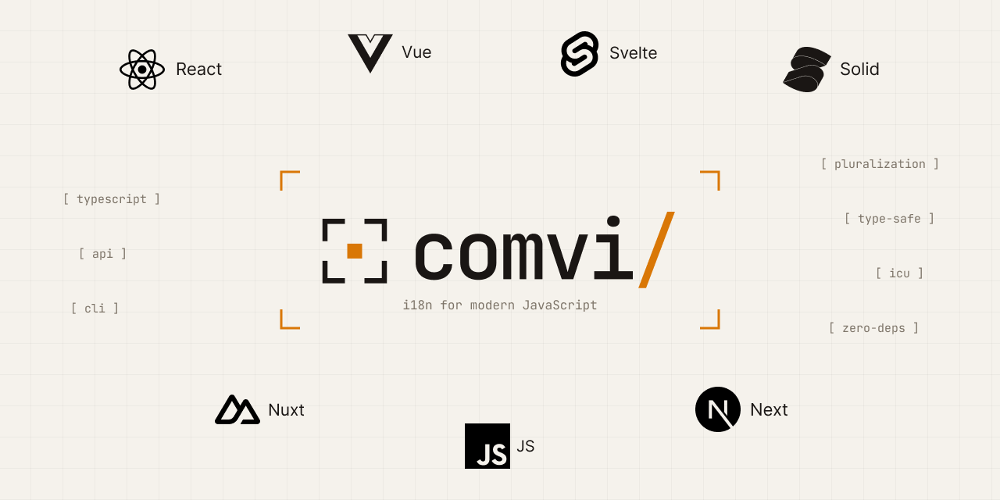

<p align="center">
  <picture>
    <source media="(prefers-color-scheme: dark)" srcset="../../.github/assets/header-logo-dark.png">
    
  </picture>
</p>

<h1 align="center">@comvi/vue</h1>

<p align="center">Vue 3 bindings for Comvi i18n: a plugin, <code>useI18n()</code>, <code>$t</code> and the <code>&lt;T&gt;</code> component.</p>

<p align="center">
  <a href="https://www.npmjs.com/package/@comvi/vue"></a>
  <a href="https://github.com/comvi-io/comvi-js/blob/main/LICENSE"></a>
  <a href="https://stackblitz.com/github/comvi-io/comvi-js/tree/main/examples/vue"></a>
</p>

---

`@comvi/vue` is the Vue 3 binding of Comvi i18n: a plugin, the `useI18n()` composable, `$t` and the
`<T>` component. Create the i18n instance, install it with `app.use(i18n)`, and read translations in
any component.

## Install

```bash
npm install @comvi/vue @comvi/core # peer: vue ^3.5.0
```

`@comvi/core` and every binding in an app must be on one version: two copies of `@comvi/core` (two
versions, or one version installed twice) throw an error that names both versions.

## Setup

```ts title="src/main.ts" check=group=vue-app
import { createApp } from "vue";
import { createI18n } from "@comvi/vue";
import App from "./App.vue";

const i18n = createI18n({
  locale: "en",
  messages: { en: { greeting: "Hello, {name}!" }, uk: { greeting: "Привіт, {name}!" } },
});
createApp(App).use(i18n).mount("#app");
```

```vue title="src/App.vue" check=group=vue-app
<script setup lang="ts">
import { useI18n } from "@comvi/vue";
const { t, locale, setLocale } = useI18n();
</script>

<template>
  <button @click="setLocale(locale === 'en' ? 'uk' : 'en')">
    {{ t("greeting", { name: "Alice" }) }}
  </button>
</template>
```

`t()` fills `{name}` from its second argument. `$t` is the same `t()` in every template. Both
catalogs are inline, so the switch loads nothing; with a `loader`, `setLocale()` can reject: see
[A rejected `setLocale()`](#a-rejected-setlocale).

## Typed keys

Typed keys come from JSON catalogs: `src/locales/<locale>.json` is the `default` namespace,
`src/locales/<namespace>/<locale>.json` the others. Install `@comvi/vite-plugin` as a dev dependency
and add `comviTypes({ from: "./src/locales", sourceLocale: "en" })` to the `plugins` of
`vite.config.ts`. `vite dev` and `vite build` then write `src/types/i18n.d.ts`; keep it inside the
`include` of your `tsconfig.json`. For `{ "greeting": "Hello, {name}!" }` in `src/locales/en.json`
the file reads, after a header comment:

<!-- prettier-ignore -->
```ts title="src/types/i18n.d.ts" check=group=vue-typed
import '@comvi/core';

declare module '@comvi/core' {
  interface Catalogs {
    "default": {
      "greeting": { "name": string | number };
    };
  }
}

export {};
```

From then on, a key that is not in the catalog is a type error that `vue-tsc` reports:

```vue title="src/Greeting.vue" check=group=vue-typed check=expect-error
<script setup lang="ts">
import { useI18n } from "@comvi/vue";
const { t } = useI18n();
</script>

<template>
  <!-- "greting" is not a key -->
  <h1>{{ t("greting", { name: "Alice" }) }}</h1>
</template>
```

A param the message uses is required too. A misspelt namespace is an error in `useI18n(ns)` and
`t(key, { ns })`, and still compiles in `load()`, `add()`, `has()` and the `namespaces` option
([limit](https://comvi.io/docs/i18n/limitations#namespace-typos-config)). Without Vite, see
[Type safety](https://comvi.io/docs/i18n/type-safety).

## Namespaces: `isReady`, `isLoading` and `ready`

`useI18n("account")` binds `t` to the `account` namespace and holds the namespace while the
component is mounted: it loads for the locale on screen and for every locale a switch goes to.
`isReady` is `true` when a catalog of the namespace is usable for the locale on screen; `isLoading`
is `true` while one is on the way. Check `isReady` first: a switch loads the new catalogs beside the
text on screen. Both `false` means the text is not available and nothing is loading. `i18n.ready` is
something else: a promise that resolves when the loads in flight have settled, the failed ones too.
After a failed first load, `ready` has resolved and `isReady` is `false`.

### Retry with `load()`

A namespace whose load failed renders its "not available" branch, and mounting the component again
does not call the loader. `i18n.load(ns)` does: it calls the loader again for the catalogs of `ns`
that failed, and it rejects with the loader's error when the catalog of the locale on screen fails
again.

```vue title="src/Account.vue" check=group=vue-app
<script setup lang="ts">
import { useI18n } from "@comvi/vue";
const { t, isReady, isLoading, i18n } = useI18n("account");
// A rejection needs no handling here: `isReady` stays false and `onError` has the report.
const retry = () => i18n.load("account").catch(() => {});
</script>

<template>
  <h2 v-if="isReady">{{ t("title") }}</h2>
  <p v-else-if="isLoading" class="spinner" />
  <button v-else @click="retry">Not available. Retry</button>
</template>
```

## Load from Comvi

`cdn()` from `@comvi/core/cdn` is a `loader` that reads the catalogs your Comvi project published to
its CDN. Nothing gates the first paint: mount the app after `i18n.ready` resolves, or branch on
`isReady` in the root component.

### `messages` beside `loader`

An inline catalog (`messages`, `catalogs` or `add()`) switches off loading for its own pair of
locale and namespace, and for nothing else: the loader is never asked for that pair, while other
namespaces of that locale and the same namespace in other locales still load. So do not inline a
catalog the CDN should serve. For a bundled catalog that is used when the CDN does not answer, pass
`fallback`: it is a spare, not a base that the CDN's catalog is laid over
([limit](https://comvi.io/docs/i18n/limitations#messages-and-loader)).

### Report errors with `onError`

`onError` receives every problem as an object with a `code` (`load_failed`, `missing_key` and
others) and the `locale`, `ns` and `key` it concerns. Without it, a development build prints
problems to the console and a production build prints nothing. `onError` reports and changes nothing
else: after a failed first load `i18n.ready` still resolves and `t()` renders the key, so what the
user sees is up to your `isReady` branch and your `catch` of `setLocale()`.

```ts title="src/main.ts" check=group=vue-cdn
import { createApp } from "vue";
import { createI18n } from "@comvi/vue";
import { cdn } from "@comvi/core/cdn";
import App from "./App.vue";
import en from "./locales/en.json";

const i18n = createI18n({
  locale: "en",
  loader: cdn("https://cdn.comvi.io/<project-token>", {
    fallback: { en: () => en }, // keys: "<locale>", or "<locale>:<namespace>"
  }),
  onError(error) {
    if (error.code === "load_failed")
      console.error(`No catalog for ${error.locale}/${error.ns}`, error.cause);
  },
});

i18n.ready.then(() => createApp(App).use(i18n).mount("#app"));
```

## A rejected `setLocale()`

With a `loader`, `setLocale()` loads the new locale's catalogs before it switches. When none of them
loads, the promise rejects with the loader's error, `onError` gets `load_failed`, and the locale and
the text on screen stay as they were. Calling `setLocale()` again calls the loader again. `locale`
is a writable ref: assigning to it (a `v-model`) switches the same way, and after a failed switch it
holds the old locale and nothing rejects.

```vue title="src/LocaleSwitcher.vue" check=group=vue-app
<script setup lang="ts">
import { ref } from "vue";
import { useI18n } from "@comvi/vue";
const { locale, setLocale } = useI18n();
const failed = ref(false);
const switchTo = (code: string) =>
  setLocale(code).then(
    () => (failed.value = false),
    () => (failed.value = true),
  );
</script>

<template>
  <button @click="switchTo(locale === 'en' ? 'uk' : 'en')">{{ locale }}</button>
  <p v-if="failed" role="alert">Could not switch the language. Try again.</p>
</template>
```

## Markup in a translation

```vue check=group=vue-app
<script setup lang="ts">
import { T } from "@comvi/vue";
</script>

<template>
  <!-- "terms": "Read the <link>terms</link> <b>in full</b>." -->
  <T i18n-key="terms" :components="{ b: 'strong' }">
    <template #link="{ children }">
      <a href="/terms">{{ children }}</a>
    </template>
  </T>
</template>
```

A tag renders through an attribute of its name (a function that gets the tag's content), else
through its `components` entry (a tag name, a component, or `{ component, props }`), else through a
slot of its name (`children` is the tag's text), else as its inner text. Every attribute but
`i18n-key`, `components`, `ns`, `locale` and `markers` is a param, and a param is always text, a
VNode too ([limit](https://comvi.io/docs/i18n/limitations#params-are-text)).

## Server rendering

Create an i18n instance per request with the options the browser uses (`timeZone` is required),
`await i18n.ready`, render with `createSSRApp(App).use(i18n)`, and embed `handover(i18n)` (an export
of `@comvi/vue`) in the page as JSON. `useI18n(ns)` loads its namespace before the component renders
on the server. In the browser, `createI18n({ ...options, ...payload })` starts from the server's
state: hydration matches, and the loader is asked for nothing the server sent
([Server-side rendering](https://comvi.io/docs/i18n/ssr)).

## Limits

[Limits](https://comvi.io/docs/i18n/limitations) lists what Comvi i18n does not do. Among its
entries:

- [`{count, number}` and `{when, date}` are not message syntax](https://comvi.io/docs/i18n/limitations#no-number-date-args): format the value with `useFormat()` from `@comvi/vue/format` and pass the result as a plain param.
- [A handed-over catalog replaces the browser's catalog of the same locale and namespace whole](https://comvi.io/docs/i18n/limitations#handover-replaces-slot).
- [After a switch, a component inside a deactivated `<KeepAlive>` loads its namespace when it is activated again](https://comvi.io/docs/i18n/limitations#vue-keepalive).

Read next: the [Vue guide](https://comvi.io/docs/i18n/vue) and
[Loading translations](https://comvi.io/docs/i18n/loading-translations).

## License

[MIT](https://github.com/comvi-io/comvi-js/blob/main/LICENSE) © Comvi
